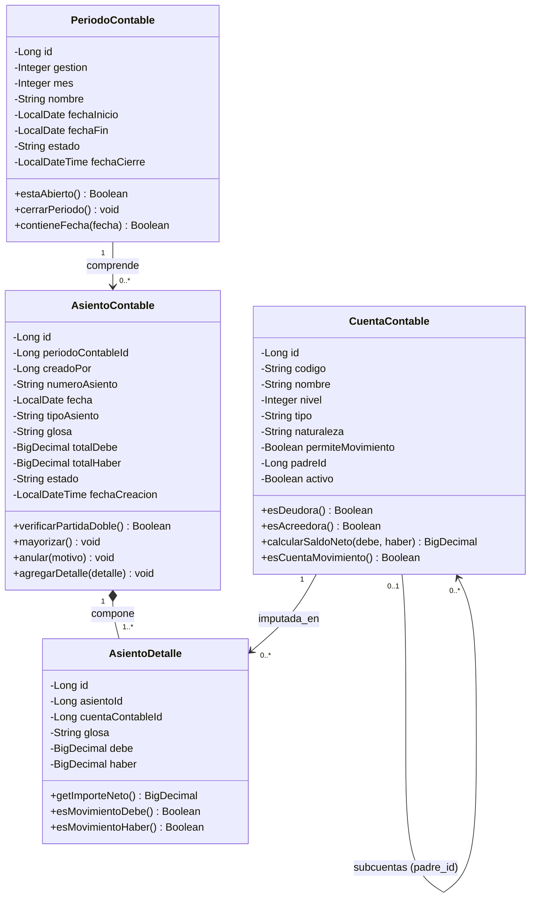

# Módulo de Contabilidad y Finanzas
## Especificación de Casos de Uso (CU30, CU31), Historias de Usuario, Diseño de Clases y Diagramas de Secuencia (Enterprise Architect)

---

## 1. Análisis de Dependencias de los Casos de Uso

Antes de iniciar el desarrollo, es indispensable responder con precisión: **¿Dependen estos dos CU de otros? ¿Tienen que estar hechos otros CU primero?**

### A nivel funcional y de negocio (Flujo de Datos):
**Sí, dependen conceptualmente de la información producida por 3 casos de uso previos:**
1. **CU25 (Gestionar Plan de Cuentas):** CU30 y CU31 requieren que existan cuentas contables creadas y clasificadas por su código, nombre, nivel, tipo (`ACTIVO`, `PASIVO`, `PATRIMONIO`, `INGRESO`, `EGRESO`) y naturaleza (`DEUDORA`, `ACREEDORA`), así como la marca de si permiten movimiento (`permite_movimiento = TRUE`).
2. **CU26 (Gestionar Periodos Contables):** Requieren la existencia de periodos contables (gestión, mes, fechas de inicio y fin) para que los filtros temporales y de cierre funcionen.
3. **CU27 (Gestionar Asientos Contables):** Para que el Libro Diario muestre asientos, el Libro Mayor calcule movimientos y saldos, y los Estados Financieros (CU31) reflejen cifras reales, deben existir asientos contables registrados y en estado `MAYORIZADO`.
4. **CU01 / CU03 (Seguridad y Permisos):** Requieren sesión activa y permisos efectivos de consulta contable (`CONTABILIDAD_CONSULTAR`).

### A nivel técnico y de desarrollo (¿Puedes empezar ya a programar?):
**¡Sí, puedes desarrollarlos de inmediato sin esperar a nadie!**
- **Estructura de Base de Datos ya existente:** Las tablas necesarias (`CUENTAS_CONTABLES`, `PERIODOS_CONTABLES`, `ASIENTOS_CONTABLES`, `ASIENTO_DETALLES`) ya están completamente definidas en `tenant_schema.sql` y migradas en la base de datos.
- **Datos de prueba ya cargados (Semillas):** El script maestro `ERP_Asus.sql` y las migraciones del tenant ya incluyen un Plan de Cuentas completo de 4 niveles, periodos contables configurados y asientos contables mayorizados reales (`AS-2026-0001`, `AS-2026-0002`).
- Por lo tanto, tu backend puede consultar directamente las tablas y tu frontend puede renderizar los libros y reportes financieros sin ningún bloqueo.

---

## 2. Fichas Formales de Casos de Uso

### CU30 - Consultar Libros Contables (Diario y Mayor)

| CU30 - Consultar Libros Contables (Diario y Mayor) | Descripción |
| :--- | :--- |
| **Propósito** | Permitir al personal contable y administrativo consultar, auditar y exportar los registros oficiales de transacciones económicas en formato de **Libro Diario** (asientos cronológicos detallados por partida doble) y **Libro Mayor** (movimientos y saldos acumulados progresivos agrupados por cada cuenta contable del catálogo), filtrables por periodo contable, cuenta y rango de fechas. |
| **Actores** | Contador del ERP, Auxiliar Contable, Auditor, Administrador del Sistema. |
| **Iniciador** | Contador del ERP / Auxiliar Contable. |
| **Precondiciones** | • El usuario debe haber iniciado sesión en el sistema y contar con permisos de consulta en el módulo contable.<br>• Debe existir al menos un periodo contable registrado en la empresa.<br>• El catálogo de cuentas contables debe estar cargado y contar con cuentas que admiten movimiento.<br>• Deben existir asientos contables registrados en el sistema. |
| **Flujo Principal** | **1.** El usuario selecciona la opción Consultar Libros Contables dentro del módulo de Contabilidad y Finanzas.<br>**2.** El sistema presenta la interfaz con dos vistas de consulta: Libro Diario y Libro Mayor, mostrando por defecto el Libro Diario con los filtros del periodo contable en curso.<br>**3.** *Consulta del Libro Diario:*<br>&nbsp;&nbsp;&nbsp;&nbsp;**a.** El usuario selecciona los criterios de búsqueda: periodo contable, rango de fechas (desde / hasta), tipo de asiento (Diario, Ingreso, Egreso, Traspaso, Ajuste o Todos) y estado del asiento (Mayorizado, Borrador o Todos).<br>&nbsp;&nbsp;&nbsp;&nbsp;**b.** El usuario presiona el botón Consultar.<br>&nbsp;&nbsp;&nbsp;&nbsp;**c.** El sistema valida los filtros ingresados y recupera los asientos en orden cronológico ascendente por fecha y número de correlativo.<br>&nbsp;&nbsp;&nbsp;&nbsp;**d.** El sistema muestra para cada asiento su número correlativo, fecha, tipo, glosa general, estado y el detalle de cuentas afectadas con sus respectivos importes en las columnas Debe y Haber.<br>&nbsp;&nbsp;&nbsp;&nbsp;**e.** El sistema totaliza las columnas Debe y Haber del listado consultado, confirmando la igualdad por partida doble.<br>**4.** *Consulta del Libro Mayor:*<br>&nbsp;&nbsp;&nbsp;&nbsp;**a.** El usuario cambia a la vista de Libro Mayor.<br>&nbsp;&nbsp;&nbsp;&nbsp;**b.** El usuario selecciona una cuenta contable específica (o la totalidad de cuentas) y el periodo o intervalo de fechas.<br>&nbsp;&nbsp;&nbsp;&nbsp;**c.** El usuario presiona Consultar Mayor.<br>&nbsp;&nbsp;&nbsp;&nbsp;**d.** El sistema calcula el Saldo Inicial acumulado antes de la fecha de inicio según la naturaleza de la cuenta (deudora o acreedora).<br>&nbsp;&nbsp;&nbsp;&nbsp;**e.** El sistema lista ordenadamente los movimientos del periodo, mostrando fecha, número de asiento, glosa particular, débitos, créditos y el saldo resultante en cada movimiento.<br>&nbsp;&nbsp;&nbsp;&nbsp;**f.** El sistema presenta el resumen de la cuenta con la sumatoria del periodo (Total Débitos, Total Créditos) y el Saldo Actual de cierre.<br>**5.** El usuario puede solicitar la exportación de los libros contables a documento PDF, hoja de cálculo Excel o vista imprimible.<br>**6.** El sistema genera el archivo con el encabezado legal de la empresa, NIT, periodo consultado, detalle contable y casillas de firma de auditoría. |
| **Postcondiciones** | • La información de los libros contables queda visualizada en pantalla para su análisis y auditoría sin alterar los registros en el sistema.<br>• Si el usuario solicitó exportar, se descarga el reporte contable formateado. |
| **Excepciones** | • **E1: Rango de fechas inválido:** La fecha inicial es mayor a la fecha final. El sistema notifica la inconsistencia y no ejecuta la consulta.<br>• **E2: Sin movimientos en el periodo:** No existen asientos que cumplan los filtros seleccionados. El sistema muestra un mensaje informativo indicando la ausencia de datos.<br>• **E3: Cuenta sin movimiento:** Se intenta consultar el mayor de una cuenta de agrupación (padre). El sistema advierte que el mayor solo aplica a cuentas analíticas de último nivel. |

---

### CU31 - Consultar Información Financiera

| CU31 - Consultar Información Financiera | Descripción |
| :--- | :--- |
| **Propósito** | Permitir a los directores, administradores y personal contable generar, analizar y exportar los Estados Financieros oficiales de la empresa: el **Balance General** (situación de Activos, Pasivos y Patrimonio con verificación de la ecuación patrimonial) y el **Estado de Resultados** (cálculo de Ingresos, Costos, Gastos y Utilidad/Pérdida Neta) para una gestión, periodo contable o fecha de corte seleccionada. |
| **Actores** | Gerente General, Director Financiero, Contador del ERP, Auditor, Administrador. |
| **Iniciador** | Contador del ERP / Gerente General. |
| **Precondiciones** | • El usuario debe haber iniciado sesión con permisos para consultar información financiera.<br>• El plan de cuentas debe tener definidas correctamente las clasificaciones de Activo, Pasivo, Patrimonio, Ingresos y Egresos.<br>• Deben existir asientos contables mayorizados correspondientes al periodo a evaluar. |
| **Flujo Principal** | **1.** El usuario ingresa a la opción Consultar Información Financiera dentro de Contabilidad y Finanzas.<br>**2.** El sistema presenta la interfaz con dos reportes disponibles: Balance General y Estado de Resultados, cargando por defecto el Balance General y el periodo fiscal en curso.<br>**3.** *Generación del Balance General:*<br>&nbsp;&nbsp;&nbsp;&nbsp;**a.** El usuario selecciona la gestión contable, el mes de corte o fecha límite de evaluación y el nivel de detalle de las cuentas (Capítulos, Grupos, Subgrupos o Cuentas de detalle).<br>&nbsp;&nbsp;&nbsp;&nbsp;**b.** El usuario presiona Generar Balance General.<br>&nbsp;&nbsp;&nbsp;&nbsp;**c.** El sistema calcula los saldos acumulados hasta la fecha de corte para las cuentas de Activo, Pasivo y Patrimonio a partir de los asientos mayorizados.<br>&nbsp;&nbsp;&nbsp;&nbsp;**d.** El sistema calcula el Resultado del Ejercicio (Ingresos acumulados menos Costos y Gastos a la fecha de corte) y lo incorpora automáticamente en la sección de Patrimonio.<br>&nbsp;&nbsp;&nbsp;&nbsp;**e.** El sistema estructura y presenta el reporte en árbol jerárquico: Total Activo (Corriente y No Corriente), Total Pasivo (Corriente y No Corriente) y Total Patrimonio.<br>&nbsp;&nbsp;&nbsp;&nbsp;**f.** El sistema valida la ecuación contable: Total Activo = Total Pasivo + Total Patrimonio. Si la diferencia es cero, muestra la confirmación de balance cuadrado; si existe descuadre, alerta la diferencia detectada.<br>**4.** *Generación del Estado de Resultados:*<br>&nbsp;&nbsp;&nbsp;&nbsp;**a.** El usuario selecciona el reporte Estado de Resultados.<br>&nbsp;&nbsp;&nbsp;&nbsp;**b.** El usuario define el periodo de tiempo a evaluar (gestión, mes o rango de fechas) y el nivel de profundidad de cuentas.<br>&nbsp;&nbsp;&nbsp;&nbsp;**c.** El usuario presiona Generar Estado de Resultados.<br>&nbsp;&nbsp;&nbsp;&nbsp;**d.** El sistema procesa los movimientos de las cuentas de ingresos y egresos del periodo: suma de Ingresos Operativos, deducción de Costo de Ventas (obteniendo la Utilidad Bruta), deducción de Gastos Operativos (obteniendo el Resultado de Operación) e inclusión de otros ingresos/gastos no operativos.<br>&nbsp;&nbsp;&nbsp;&nbsp;**e.** El sistema calcula y muestra la Utilidad o Pérdida Neta del Ejercicio, junto con los porcentajes de participación de cada rubro.<br>**5.** El usuario puede seleccionar la opción de exportar el estado financiero a formato PDF, hoja de cálculo Excel o imprimirlo.<br>**6.** El sistema genera el documento oficial con la identificación de la empresa, título del estado financiero, moneda, periodo y espacios para firmas del Contador y Representante Legal. |
| **Postcondiciones** | • La situación económica y patrimonial de la empresa queda expuesta para la toma de decisiones y el cumplimiento normativo.<br>• Si se solicitó la exportación, se emite el informe financiero formal. |
| **Excepciones** | • **E1: Periodo sin registros contables:** No existen transacciones registradas en el periodo seleccionado. El sistema advierte que no es posible generar el estado financiero sin movimientos.<br>• **E2: Descuadre en ecuación patrimonial:** Por asientos descuadrados o cuentas sin naturaleza definida, el Total Activo no iguala a la suma de Pasivo y Patrimonio. El sistema advierte el monto descuadrado para corrección contable.<br>• **E3: Parámetros temporales inconsistentes:** Rango de fechas no válido para la generación del estado de resultados. |

---

## 3. Historias de Usuario (HU30 y HU31)

> **Nota de redacción:** Las Historias de Usuario describen estrictamente el comportamiento del software desde la perspectiva funcional y de negocio del usuario, sin menciones a tecnologías de backend, frontend, protocolos ni infraestructura técnica.

### HU30 - Consultar Libros Contables (Diario y Mayor)

| Historia de Usuario | | | |
| :--- | :--- | :--- | :--- |
| **ID** | **Nombre corto de HU** | **Prioridad** | **PHU** |
| HU30 | Consultar Libros Contables | Alta | Por hacer |
| **Como** | Contador del ERP (responsable de la contabilidad y fiscalización). | | |
| **Quiero** | Consultar, filtrar y exportar los registros del Libro Diario y del Libro Mayor general de la empresa. | | |
| **Para** | Auditar la cronología de las operaciones contables, verificar el cumplimiento de la partida doble y conocer el saldo histórico de cada cuenta contable. | | |
| **Criterios de aceptación** | ◆ **Selección de vista:** El sistema debe permitir alternar fácilmente entre la vista del Libro Diario y la vista del Libro Mayor.<br>◆ **Filtros del Libro Diario:** Se debe poder filtrar por periodo contable, rango de fechas (desde / hasta), tipo de asiento (Diario, Ingreso, Egreso, Traspaso, Ajuste o Todos) y estado del asiento (Borrador, Mayorizado o Todos).<br>◆ **Detalle del Libro Diario:** Cada asiento del Libro Diario debe mostrar su fecha, número correlativo, tipo de comprobante, glosa general, estado y el desglose de cada una de sus cuentas con código, nombre y sus montos en el Debe o en el Haber.<br>◆ **Verificación de partida doble:** El sistema debe calcular y mostrar el total del Debe y el total del Haber del conjunto de asientos consultados, evidenciando que ambas sumas sean exactamente iguales.<br>◆ **Filtros del Libro Mayor:** Se debe poder consultar el mayor seleccionando una cuenta contable específica o todas las cuentas de movimiento, dentro de un periodo contable o rango de fechas definido.<br>◆ **Saldo anterior en el Mayor:** El sistema debe calcular y mostrar el saldo inicial acumulado antes de la fecha inicial seleccionada, sumando o restando débitos y créditos según la naturaleza de la cuenta (deudora o acreedora).<br>◆ **Movimientos y saldo progresivo:** Cada movimiento en el Libro Mayor debe exhibir su fecha, número de asiento origen, concepto o glosa, importe en el Debe, importe en el Haber y el saldo resultante actualizado fila por fila.<br>◆ **Resumen de cuenta:** Al final de cada cuenta en el Mayor, el sistema debe presentar el Total Débitos del periodo, Total Créditos del periodo y el Saldo Final.<br>◆ **Cuentas analíticas:** La consulta del Libro Mayor solo debe permitir seleccionar cuentas que admiten movimientos (cuentas de último nivel); las cuentas de agrupación no deben emitir mayor individual.<br>◆ **Exportación:** El sistema debe permitir descargar los reportes en formato PDF y hoja de cálculo para su archivo físico o presentación ante auditorías.<br>◆ **Permisos de acceso:** La consulta de libros contables debe estar reservada exclusivamente para usuarios que cuenten con autorización de consulta contable; usuarios no autorizados no podrán visualizar la información. | | |
| **Conversación/reglas** | • Los asientos generados automáticamente por ventas, cobros, compras o notas de crédito se reflejan en el Libro Diario con su respectiva referencia al documento comercial.<br>• Por defecto, la consulta de libros contables presenta únicamente asientos en estado mayorizado para asegurar la veracidad de la información oficial.<br>• El orden del Libro Diario siempre es estrictamente cronológico ascendente (por fecha y número de asiento).<br>• Si se ingresa una fecha final anterior a la fecha inicial, el sistema impide la búsqueda y solicita corregir el rango.<br>• Toda consulta y exportación queda registrada en la bitácora de auditoría del sistema para control de accesos a información financiera sensible. | | |
| **Desarrollador** | Alessandro Yevara Ponce (Backend y Frontend) | | |

---

### HU31 - Consultar Información Financiera

| Historia de Usuario | | | |
| :--- | :--- | :--- | :--- |
| **ID** | **Nombre corto de HU** | **Prioridad** | **PHU** |
| HU31 | Consultar Información Financiera | Alta | Por hacer |
| **Como** | Gerente General o Contador del ERP. | | |
| **Quiero** | Generar y analizar el Balance General y el Estado de Resultados de la empresa para un periodo contable o fecha de corte seleccionada. | | |
| **Para** | Conocer la situación patrimonial real de la empresa, evaluar las utilidades o pérdidas del negocio y sustentar decisiones estratégicas y tributarias. | | |
| **Criterios de aceptación** | ◆ **Elección de estado financiero:** El sistema debe permitir seleccionar claramente entre generar el Balance General (Estado de Situación Patrimonial) o el Estado de Resultados (Pérdidas y Ganancias).<br>◆ **Filtros temporales:** Para el Balance General se debe poder seleccionar la gestión y el mes o fecha exacta de corte. Para el Estado de Resultados se debe poder seleccionar el periodo de tiempo o intervalo de fechas a evaluar.<br>◆ **Niveles de agrupación:** El usuario debe poder definir el nivel de profundidad de visualización en el árbol de cuentas (solo grupos principales, subgrupos o cuentas detalladas de movimiento).<br>◆ **Estructura del Balance General:** El reporte debe clasificar claramente los saldos en Activo (Corriente y No Corriente), Pasivo (Corriente y No Corriente) y Patrimonio (Capital, Reservas y Resultados).<br>◆ **Incorporación de la utilidad del ejercicio:** El Balance General debe calcular automáticamente la Utilidad o Pérdida Neta del periodo e incorporarla dentro del rubro de Patrimonio para reflejar el patrimonio neto actualizado.<br>◆ **Validación de la ecuación patrimonial:** El sistema debe verificar en tiempo real que Total Activo sea igual a Total Pasivo más Total Patrimonio. Si el balance cuadra exactamente, debe mostrar un indicador visible de confirmación; si existe diferencia, debe advertir el monto descuadrado.<br>◆ **Estructura del Estado de Resultados:** El reporte debe estructurarse de forma escalonada mostrando: Ingresos Operativos menos Costo de Ventas igual a Utilidad Bruta; deducción de Gastos Operativos igual a Resultado de Operación; y adición/deducción de otros ingresos y gastos para obtener la Utilidad o Pérdida Neta final.<br>◆ **Análisis porcentual:** El Estado de Resultados debe mostrar el porcentaje que representa cada costo y gasto respecto al total de ingresos operativos.<br>◆ **Exportación formal:** Se debe permitir la exportación de ambos estados financieros a formato PDF y hoja de cálculo con la razón social, NIT, periodo, fecha de emisión y espacios para las firmas oficiales de responsabilidad.<br>◆ **Acceso restringido:** Solo los usuarios con autorización específica para consultar finanzas corporativas tienen acceso a esta pantalla; cualquier otro rol tiene el acceso bloqueado. | | |
| **Conversación/reglas** | • Solo se toman en cuenta asientos mayorizados para la emisión de los estados financieros; los borradores quedan excluidos para no distorsionar las cifras oficiales.<br>• Las cuentas sin movimientos ni saldos dentro del periodo seleccionado se pueden ocultar de la vista para mantener el reporte limpio y conciso.<br>• Si la empresa no cuenta con transacciones contables en el año consultado, el sistema muestra los rubros principales en saldo cero con un mensaje informativo.<br>• El formato de presentación debe cumplir con la estructura contable estándar aplicable a empresas comerciales y de servicios. | | |
| **Desarrollador** | Alessandro Yevara Ponce (Backend y Frontend) | | |

---

## 4. Diseño de Clases, Tablas de Base de Datos y Métodos

Para construir los modelos en **Enterprise Architect**, tanto para el Diagrama de Clases / Tablas como para los Diagramas de Secuencia, se detallan a continuación las tablas de base de datos con sus atributos, tipos, restricciones, métodos de entidad y relaciones, seguido de los controladores, servicios y repositorios.

### 4.0. Clases del Modelo de Dominio y Tablas de Base de Datos

Cada tabla/entidad se presenta a continuación en formato de caja de clase UML con sus atributos (visibilidad privada y tipos de datos del sistema, sin código SQL) y en el compartimento inferior sus métodos:

```
+----------------------------------------------------------------------------------------------------+
|                                         PeriodoContable                                            |
+----------------------------------------------------------------------------------------------------+
| - id: Integer                                                                                      |
| - gestion: Integer                                                                                 |
| - mes: Integer                                                                                     |
| - nombre: String                                                                                   |
| - fechaInicio: LocalDate                                                                           |
| - fechaFin: LocalDate                                                                              |
| - estado: String                                                                                   |
| - fechaCierre: LocalDateTime                                                                       |
+----------------------------------------------------------------------------------------------------+
| + estaAbierto(): Boolean                                                                           |
| + cerrarPeriodo(): void                                                                            |
| + contieneFecha(fecha: LocalDate): Boolean                                                         |
+----------------------------------------------------------------------------------------------------+

+----------------------------------------------------------------------------------------------------+
|                                          CuentaContable                                            |
+----------------------------------------------------------------------------------------------------+
| - id: Integer                                                                                      |
| - codigo: String                                                                                   |
| - nombre: String                                                                                   |
| - nivel: Integer                                                                                   |
| - tipo: String                                                                                     |
| - naturaleza: String                                                                               |
| - permiteMovimiento: Boolean                                                                       |
| - padreId: Integer                                                                                 |
| - activo: Boolean                                                                                  |
+----------------------------------------------------------------------------------------------------+
| + esDeudora(): Boolean                                                                             |
| + esAcreedora(): Boolean                                                                           |
| + calcularSaldoNeto(debe: BigDecimal, haber: BigDecimal): BigDecimal                               |
| + esCuentaMovimiento(): Boolean                                                                    |
+----------------------------------------------------------------------------------------------------+

+----------------------------------------------------------------------------------------------------+
|                                         AsientoContable                                            |
+----------------------------------------------------------------------------------------------------+
| - id: Integer                                                                                      |
| - periodoContableId: Integer                                                                       |
| - creadoPor: Integer                                                                               |
| - numeroAsiento: String                                                                            |
| - fecha: LocalDate                                                                                 |
| - tipoAsiento: String                                                                              |
| - glosa: String                                                                                    |
| - totalDebe: BigDecimal                                                                            |
| - totalHaber: BigDecimal                                                                           |
| - estado: String                                                                                   |
| - fechaCreacion: LocalDateTime                                                                     |
+----------------------------------------------------------------------------------------------------+
| + verificarPartidaDoble(): Boolean                                                                 |
| + mayorizar(): void                                                                                |
| + anular(motivo: String): void                                                                     |
| + agregarDetalle(detalle: AsientoDetalle): void                                                    |
+----------------------------------------------------------------------------------------------------+

+----------------------------------------------------------------------------------------------------+
|                                         AsientoDetalle                                             |
+----------------------------------------------------------------------------------------------------+
| - id: Integer                                                                                      |
| - asientoId: Integer                                                                               |
| - cuentaContableId: Integer                                                                        |
| - glosa: String                                                                                    |
| - debe: BigDecimal                                                                                 |
| - haber: BigDecimal                                                                                |
+----------------------------------------------------------------------------------------------------+
| + getImporteNeto(): BigDecimal                                                                     |
| + esMovimientoDebe(): Boolean                                                                      |
| + esMovimientoHaber(): Boolean                                                                     |
+----------------------------------------------------------------------------------------------------+
```

#### Relaciones y Cardinalidades del Modelo:
- **`PeriodoContable (1)` $\rightarrow$ `(0..*) AsientoContable`:** Un periodo contable comprende múltiples asientos contables registrados durante su vigencia.
- **`AsientoContable (1)` $\rightarrow$ `(1..*) AsientoDetalle`:** Relación de **Composición fuerte**; cada asiento contable contiene dos o más líneas que cumplen la partida doble.
- **`CuentaContable (1)` $\rightarrow$ `(0..*) AsientoDetalle`:** Cada línea de comprobante imputa a una cuenta contable específica que permite movimiento.
- **`CuentaContable (0..1)` $\rightarrow$ `(0..*) CuentaContable`:** Relación reflexiva/recursiva para la estructura en árbol del plan de cuentas mediante `padreId`.

---

### Diagrama de Clases del Dominio Contable (Mermaid)



---

### 4.1. Clases de Aplicación para CU30 - Consultar Libros Contables

```
+----------------------------------------------------------------------------------------------------+
|                                    LibrosContablesController                                       |
+----------------------------------------------------------------------------------------------------+
| - service: LibrosContablesService                                                                  |
+----------------------------------------------------------------------------------------------------+
| + consultarLibroDiario(periodoId: Long, inicio: LocalDate, fin: LocalDate,                         |
|                       tipo: String, estado: String): ResponseEntity<LibroDiarioResponse>           |
| + consultarLibroMayor(cuentaId: Long, periodoId: Long, inicio: LocalDate,                           |
|                      fin: LocalDate): ResponseEntity<LibroMayorResponse>                           |
| + exportarLibroDiario(periodoId: Long, inicio: LocalDate, fin: LocalDate,                           |
|                      tipo: String, estado: String, fmt: String): ResponseEntity<byte[]>            |
| + exportarLibroMayor(cuentaId: Long, periodoId: Long, inicio: LocalDate,                            |
|                     fin: LocalDate, fmt: String): ResponseEntity<byte[]>                           |
+----------------------------------------------------------------------------------------------------+

+----------------------------------------------------------------------------------------------------+
|                                      LibrosContablesService                                        |
+----------------------------------------------------------------------------------------------------+
| + obtenerLibroDiario(periodoId: Long, inicio: LocalDate, fin: LocalDate,                           |
|                     tipo: String, estado: String): LibroDiarioResponse                             |
| + obtenerLibroMayor(cuentaId: Long, periodoId: Long, inicio: LocalDate,                             |
|                    fin: LocalDate): LibroMayorResponse                                             |
| + calcularSaldoInicial(cuentaId: Long, fechaInicio: LocalDate, nat: String): BigDecimal            |
| + calcularMovimientosMayor(cuentaId: Long, inicio: LocalDate, fin: LocalDate,                       |
|                           saldoIni: BigDecimal, nat: String): List<MovimientoMayorDTO>             |
| + exportarDiarioPdf(response: LibroDiarioResponse): byte[]                                         |
| + exportarMayorPdf(response: LibroMayorResponse): byte[]                                           |
+----------------------------------------------------------------------------------------------------+

+----------------------------------------------------------------------------------------------------+
|                                     AsientoContableRepository                                      |
+----------------------------------------------------------------------------------------------------+
| + findAsientosConFiltros(periodoId: Long, inicio: LocalDate, fin: LocalDate,                       |
|                         tipo: String, estado: String): List<AsientoContable>                       |
| + findByFechaBeforeAndEstado(fecha: LocalDate, estado: String): List<AsientoContable>              |
+----------------------------------------------------------------------------------------------------+

+----------------------------------------------------------------------------------------------------+
|                                      AsientoDetalleRepository                                      |
+----------------------------------------------------------------------------------------------------+
| + findByCuentaIdAndFechaBetween(cuentaId: Long, inicio: LocalDate, fin: LocalDate,                |
|                                estado: String): List<AsientoDetalle>                               |
| + sumDebeByCuentaIdAndFechaBefore(cuentaId: Long, fecha: LocalDate, estado: String): BigDecimal     |
| + sumHaberByCuentaIdAndFechaBefore(cuentaId: Long, fecha: LocalDate, estado: String): BigDecimal    |
+----------------------------------------------------------------------------------------------------+

+----------------------------------------------------------------------------------------------------+
|                                      CuentaContableRepository                                      |
+----------------------------------------------------------------------------------------------------+
| + findById(id: Long): Optional<CuentaContable>                                                     |
| + findByPermiteMovimientoTrueAndActivoTrue(): List<CuentaContable>                                 |
| + findByTipoAndActivoTrue(tipo: String): List<CuentaContable>                                      |
+----------------------------------------------------------------------------------------------------+

+----------------------------------------------------------------------------------------------------+
|                                       LibrosContablesMapper                                        |
+----------------------------------------------------------------------------------------------------+
| + toAsientoDiarioDTO(asiento: AsientoContable): AsientoDiarioDTO                                   |
| + toLineaAsientoDTO(detalle: AsientoDetalle): LineaAsientoDTO                                      |
| + toMovimientoMayorDTO(detalle: AsientoDetalle, saldoAcum: BigDecimal): MovimientoMayorDTO         |
+----------------------------------------------------------------------------------------------------+
```

---

### 4.2. Clases para CU31 - Consultar Información Financiera

```
+----------------------------------------------------------------------------------------------------+
|                                  InformacionFinancieraController                                   |
+----------------------------------------------------------------------------------------------------+
| - service: InformacionFinancieraService                                                            |
+----------------------------------------------------------------------------------------------------+
| + consultarBalanceGeneral(gestion: Integer, mesCorte: Integer, fechaCorte: LocalDate,              |
|                          nivel: Integer): ResponseEntity<BalanceGeneralResponse>                   |
| + consultarEstadoResultados(gestion: Integer, inicio: LocalDate, fin: LocalDate,                   |
|                            nivel: Integer): ResponseEntity<EstadoResultadosResponse>               |
| + exportarBalancePdf(gestion: Integer, fechaCorte: LocalDate): ResponseEntity<byte[]>              |
| + exportarEstadoResultadosPdf(gestion: Integer, inicio: LocalDate, fin: LocalDate): ResponseEntity |
+----------------------------------------------------------------------------------------------------+

+----------------------------------------------------------------------------------------------------+
|                                    InformacionFinancieraService                                    |
+----------------------------------------------------------------------------------------------------+
| + generarBalanceGeneral(gestion: Integer, mesCorte: Integer, fechaCorte: LocalDate,                |
|                        nivel: Integer): BalanceGeneralResponse                                     |
| + generarEstadoResultados(gestion: Integer, inicio: LocalDate, fin: LocalDate,                     |
|                          nivel: Integer): EstadoResultadosResponse                                 |
| + calcularSaldosCuentas(cuentas: List<CuentaContable>, fechaCorte: LocalDate): Map<Long,BigDecimal>|
| + calcularUtilidadEjercicio(inicio: LocalDate, fin: LocalDate): BigDecimal                         |
| + estructurarArbol(cuentas: List<CuentaContable>, saldos: Map<Long,BigDecimal>,                    |
|                   tipo: String, nivelMax: Integer): List<NodoFinancieroDTO>                        |
| + validarEcuacion(totalAct: BigDecimal, totalPas: BigDecimal, totalPat: BigDecimal): CuadreDTO     |
+----------------------------------------------------------------------------------------------------+

+----------------------------------------------------------------------------------------------------+
|                                       CalculadoraFinanciera                                        |
+----------------------------------------------------------------------------------------------------+
| + calcularUtilidadBruta(ingresos: BigDecimal, costoVentas: BigDecimal): BigDecimal                 |
| + calcularResultadoOperativo(utilidadBruta: BigDecimal, gastosOperativos: BigDecimal): BigDecimal  |
| + calcularUtilidadNeta(resOperativo: BigDecimal, otrosIng: BigDecimal, otrosGas: BigDecimal): BigDec|
| + calcularAnalisisVertical(monto: BigDecimal, baseIngresos: BigDecimal): BigDecimal                |
+----------------------------------------------------------------------------------------------------+
```

---

## 5. Diagramas de Secuencia Formales (Enterprise Architect)

Siguiendo las pautas de modelado de **Enterprise Architect**:
- **Objetos y Clases:** Instancias anotadas en formato `:Clase` u `objeto:Clase`.
- **Líneas de vida:** Representadas por las líneas punteadas verticales.
- **Activaciones:** Delimitadas con `activate` y `deactivate` para indicar los períodos de procesamiento activo.
- **Mensajes:** Con firma formal del método ejecutado.
- **Fragmentos combinados:** `alt` (condición alternativa), `opt` (opcional), `loop` (repetición / bucle).
- **Destrucción:** Representada con la instrucción `destroy` al terminar el ciclo de vida del objeto temporal (marcada con una "X").

---

### Diagrama 1: CU30 - Consulta de Libro Diario (con bucles de detalle y cuadre)

```mermaid
sequenceDiagram
    autonumber
    actor c as :Contador
    participant ctrl as :LibrosContablesController
    participant srv as :LibrosContablesService
    participant repoAsiento as :AsientoContableRepository
    participant map as :LibrosContablesMapper
    participant resp as response :LibroDiarioResponse

    c ->> ctrl: consultarLibroDiario(periodoId, fechaInicio, fechaFin, tipo, estado)
    activate ctrl

    ctrl ->> srv: obtenerLibroDiario(periodoId, fechaInicio, fechaFin, tipo, estado)
    activate srv

    srv ->> repoAsiento: findAsientosConFiltros(periodoId, fechaInicio, fechaFin, tipo, estado)
    activate repoAsiento
    repoAsiento -->> srv: listaAsientos :List<AsientoContable>
    deactivate repoAsiento

    create participant resp as response :LibroDiarioResponse
    srv ->> resp: new LibroDiarioResponse()
    activate resp
    resp -->> srv: instanciaCreada
    deactivate resp

    loop Para cada asiento in listaAsientos
        srv ->> map: toAsientoDiarioDTO(asiento)
        activate map
        
        loop Para cada detalle in asiento.getDetalles()
            map ->> map: toLineaAsientoDTO(detalle)
        end

        map -->> srv: asientoDTO :AsientoDiarioDTO
        deactivate map

        srv ->> resp: agregarAsiento(asientoDTO)
        activate resp
        resp ->> resp: acumularTotalDebe(asientoDTO.getTotalDebe())
        resp ->> resp: acumularTotalHaber(asientoDTO.getTotalHaber())
        resp -->> srv: void
        deactivate resp
    end

    alt Total Debe == Total Haber
        srv ->> resp: setEstaCuadrado(true)
        activate resp
        resp -->> srv: void
        deactivate resp
    else Total Debe != Total Haber
        srv ->> resp: setEstaCuadrado(false)
        activate resp
        resp -->> srv: void
        deactivate resp
    end

    srv -->> ctrl: response :LibroDiarioResponse
    deactivate srv

    ctrl -->> c: 200 OK (response)
    deactivate ctrl

    opt Usuario cierra o navega fuera de la vista
        c ->> resp: destruirInstancia()
        destroy resp
    end
```

---

### Diagrama 2: CU30 - Consulta de Libro Mayor (con cálculo acumulativo de saldo)

```mermaid
sequenceDiagram
    autonumber
    actor c as :Contador
    participant ctrl as :LibrosContablesController
    participant srv as :LibrosContablesService
    participant repoCuenta as :CuentaContableRepository
    participant repoDetalle as :AsientoDetalleRepository
    participant map as :LibrosContablesMapper
    participant respMayor as mayorResp :LibroMayorResponse

    c ->> ctrl: consultarLibroMayor(cuentaId, periodoId, fechaInicio, fechaFin)
    activate ctrl

    ctrl ->> srv: obtenerLibroMayor(cuentaId, periodoId, fechaInicio, fechaFin)
    activate srv

    srv ->> repoCuenta: findById(cuentaId)
    activate repoCuenta
    repoCuenta -->> srv: cuenta :CuentaContable
    deactivate repoCuenta

    alt cuenta == null OR !cuenta.getPermiteMovimiento()
        srv -->> ctrl: throw ResponseStatusException(BAD_REQUEST)
        ctrl -->> c: 400 Bad Request ("Cuenta no admite movimientos")
    else Cuenta válida
        srv ->> srv: calcularSaldoInicial(cuentaId, fechaInicio, cuenta.getNaturaleza())
        activate srv
        srv ->> repoDetalle: sumDebeByCuentaIdAndFechaBefore(cuentaId, fechaInicio, "MAYORIZADO")
        activate repoDetalle
        repoDetalle -->> srv: totalDebeAnterior :BigDecimal
        deactivate repoDetalle

        srv ->> repoDetalle: sumHaberByCuentaIdAndFechaBefore(cuentaId, fechaInicio, "MAYORIZADO")
        activate repoDetalle
        repoDetalle -->> srv: totalHaberAnterior :BigDecimal
        deactivate repoDetalle

        alt Naturaleza == "DEUDORA"
            srv ->> srv: saldoInicial = totalDebeAnterior - totalHaberAnterior
        else Naturaleza == "ACREEDORA"
            srv ->> srv: saldoInicial = totalHaberAnterior - totalDebeAnterior
        end
        deactivate srv

        srv ->> repoDetalle: findByCuentaIdAndFechaBetween(cuentaId, fechaInicio, fechaFin, "MAYORIZADO")
        activate repoDetalle
        repoDetalle -->> srv: listaMovimientos :List<AsientoDetalle>
        deactivate repoDetalle

        create participant respMayor as mayorResp :LibroMayorResponse
        srv ->> respMayor: new LibroMayorResponse(cuenta, saldoInicial)
        activate respMayor
        respMayor -->> srv: instanciaMayor
        deactivate respMayor

        loop Para cada detalle in listaMovimientos
            alt Naturaleza == "DEUDORA"
                srv ->> srv: saldoAcumulado = saldoAcumulado + detalle.getDebe() - detalle.getHaber()
            else Naturaleza == "ACREEDORA"
                srv ->> srv: saldoAcumulado = saldoAcumulado + detalle.getHaber() - detalle.getDebe()
            end

            srv ->> map: toMovimientoMayorDTO(detalle, saldoAcumulado)
            activate map
            map -->> srv: movDTO :MovimientoMayorDTO
            deactivate map

            srv ->> respMayor: agregarMovimiento(movDTO)
            activate respMayor
            respMayor -->> srv: void
            deactivate respMayor
        end

        srv ->> respMayor: setSaldoFinal(saldoAcumulado)
        activate respMayor
        respMayor -->> srv: void
        deactivate respMayor

        srv -->> ctrl: mayorResp :LibroMayorResponse
        deactivate srv

        ctrl -->> c: 200 OK (mayorResp)
        deactivate ctrl
    end
```

---

### Diagrama 3: CU31 - Generación de Balance General (con Ecuación Patrimonial)

```mermaid
sequenceDiagram
    autonumber
    actor g as :Gerente / Contador
    participant ctrl as :InformacionFinancieraController
    participant srv as :InformacionFinancieraService
    participant repoCuenta as :CuentaContableRepository
    participant repoDetalle as :AsientoDetalleRepository
    participant calc as :CalculadoraFinanciera
    participant balResp as balance :BalanceGeneralResponse

    g ->> ctrl: consultarBalanceGeneral(gestion, mesCorte, fechaCorte, nivel)
    activate ctrl

    ctrl ->> srv: generarBalanceGeneral(gestion, mesCorte, fechaCorte, nivel)
    activate srv

    srv ->> repoCuenta: findByTipoAndActivoTrue("ACTIVO")
    activate repoCuenta
    repoCuenta -->> srv: cuentasActivo :List<CuentaContable>
    deactivate repoCuenta

    srv ->> repoCuenta: findByTipoAndActivoTrue("PASIVO")
    activate repoCuenta
    repoCuenta -->> srv: cuentasPasivo :List<CuentaContable>
    deactivate repoCuenta

    srv ->> repoCuenta: findByTipoAndActivoTrue("PATRIMONIO")
    activate repoCuenta
    repoCuenta -->> srv: cuentasPatrimonio :List<CuentaContable>
    deactivate repoCuenta

    srv ->> srv: calcularSaldosCuentas(todasLasCuentas, fechaCorte)
    activate srv
    loop Para cada cuenta in todasLasCuentas
        srv ->> repoDetalle: sumDebeByCuentaIdAndFechaBefore(cuenta.getId(), fechaCorte, "MAYORIZADO")
        activate repoDetalle
        repoDetalle -->> srv: debeTotal
        deactivate repoDetalle

        srv ->> repoDetalle: sumHaberByCuentaIdAndFechaBefore(cuenta.getId(), fechaCorte, "MAYORIZADO")
        activate repoDetalle
        repoDetalle -->> srv: haberTotal
        deactivate repoDetalle

        srv ->> srv: mapaSaldos.put(cuenta.getId(), saldoNeto)
    end
    deactivate srv

    srv ->> srv: calcularUtilidadEjercicio(fechaInicioGestion, fechaCorte)
    activate srv
    srv -->> srv: utilidadNetaPeriodo :BigDecimal
    deactivate srv

    create participant balResp as balance :BalanceGeneralResponse
    srv ->> balResp: new BalanceGeneralResponse(fechaCorte)
    activate balResp
    balResp -->> srv: instanciaBalance
    deactivate balResp

    srv ->> srv: estructurarArbol(cuentasActivo, mapaSaldos, "ACTIVO", nivel)
    srv ->> balResp: setArbolActivos(arbolActivo), setTotalActivos(sumActivos)

    srv ->> srv: estructurarArbol(cuentasPasivo, mapaSaldos, "PASIVO", nivel)
    srv ->> balResp: setArbolPasivos(arbolPasivo), setTotalPasivos(sumPasivos)

    srv ->> srv: estructurarArbol(cuentasPatrimonio, mapaSaldos, "PATRIMONIO", nivel)
    srv ->> balResp: setArbolPatrimonio(arbolPatrimonio), setTotalPatrimonio(sumPatrimonio + utilidadNetaPeriodo)

    srv ->> srv: validarEcuacion(totalActivos, totalPasivos, totalPatrimonio)
    activate srv
    srv ->> calc: evaluarDiferencia(totalActivos, totalPasivos + totalPatrimonio)
    activate calc
    calc -->> srv: diferencia :BigDecimal
    deactivate calc

    alt diferencia == 0.00
        srv ->> balResp: setEstaCuadrado(true)
    else diferencia != 0.00
        srv ->> balResp: setEstaCuadrado(false), setDiferencia(diferencia)
    end
    deactivate srv

    srv -->> ctrl: balance :BalanceGeneralResponse
    deactivate srv

    ctrl -->> g: 200 OK (balance)
    deactivate ctrl
```

---

### Diagrama 4: CU31 - Generación de Estado de Resultados (con Análisis Escalonado)

```mermaid
sequenceDiagram
    autonumber
    actor g as :Gerente / Contador
    participant ctrl as :InformacionFinancieraController
    participant srv as :InformacionFinancieraService
    participant repoCuenta as :CuentaContableRepository
    participant repoDetalle as :AsientoDetalleRepository
    participant calc as :CalculadoraFinanciera
    participant estResp as estadoResp :EstadoResultadosResponse

    g ->> ctrl: consultarEstadoResultados(gestion, fechaInicio, fechaFin, nivel)
    activate ctrl

    ctrl ->> srv: generarEstadoResultados(gestion, fechaInicio, fechaFin, nivel)
    activate srv

    srv ->> repoCuenta: findByTipoAndActivoTrue("INGRESO")
    activate repoCuenta
    repoCuenta -->> srv: cuentasIngreso :List<CuentaContable>
    deactivate repoCuenta

    srv ->> repoCuenta: findByTipoAndActivoTrue("EGRESO")
    activate repoCuenta
    repoCuenta -->> srv: cuentasEgreso :List<CuentaContable>
    deactivate repoCuenta

    srv ->> srv: calcularSaldosPeriodo(cuentasIngreso, fechaInicio, fechaFin)
    activate srv
    srv -->> srv: totalIngresosOperativos :BigDecimal
    deactivate srv

    srv ->> srv: calcularSaldosPeriodo(cuentasCosto, fechaInicio, fechaFin)
    activate srv
    srv -->> srv: totalCostoVentas :BigDecimal
    deactivate srv

    srv ->> calc: calcularUtilidadBruta(totalIngresosOperativos, totalCostoVentas)
    activate calc
    calc -->> srv: utilidadBruta :BigDecimal
    deactivate calc

    srv ->> srv: calcularSaldosPeriodo(cuentasGastoOperativo, fechaInicio, fechaFin)
    activate srv
    srv -->> srv: totalGastosOperativos :BigDecimal
    deactivate srv

    srv ->> calc: calcularResultadoOperativo(utilidadBruta, totalGastosOperativos)
    activate calc
    calc -->> srv: resultadoOperativo :BigDecimal
    deactivate calc

    srv ->> calc: calcularUtilidadNeta(resultadoOperativo, otrosIngresos, otrosGastos)
    activate calc
    calc -->> srv: utilidadNeta :BigDecimal
    deactivate calc

    create participant estResp as estadoResp :EstadoResultadosResponse
    srv ->> estResp: new EstadoResultadosResponse(ingresos, costos, gastos, utilidadNeta)
    activate estResp
    estResp -->> srv: instanciaEstado
    deactivate estResp

    loop Para cada cuenta in cuentasIngreso + cuentasEgreso
        srv ->> calc: calcularAnalisisVertical(cuenta.getSaldo(), totalIngresosOperativos)
        activate calc
        calc -->> srv: porcentajeVertical :BigDecimal
        deactivate calc
        srv ->> estResp: registrarPorcentajeCuenta(cuenta.getId(), porcentajeVertical)
    end

    srv -->> ctrl: estadoResp :EstadoResultadosResponse
    deactivate srv

    ctrl -->> g: 200 OK (estadoResp)
    deactivate ctrl
```
